I am currently a last year Ph.D. candidate at Tsinghua University, supervised by Prof. [Xiu Li](https://thusigsiclab.github.io/thu.github.io/).
I was fortunate to be a visiting student at MMLAB@NTU, where I worked with Prof. [Ziwei Liu](https://liuziwei7.github.io/index.html) on the intersection of MLLM and human motion.
Earlier in my Ph.D. journey, I had the opportunity to explore digital human modeling under the kind guidance of Prof. [Yebin Liu](http://www.liuyebin.com/).
Before beginning my Ph.D., I obtained my master’s degree from Northeastern University, where I conducted research on vision-language models under the supervision of Prof. Lu Meng.
My research interests lie in <strong>human-centered vision, including modeling human motion and human-centric interactions for avatars, generative models, MLLMs and embodied intelligence</strong>.

_______________________________________________________________________________________________________
<h3>
   🆕News
</h3>

  <li> <strong>[Oct 2025]</strong> One first-author paper about long dance generation accepted by TPAMI!</li>
  <li> <strong>[Jun 2025]</strong> Recognized as <strong>outstanding</strong> reviewer at CVPR 2025!</li>
  <li> <strong>[May 2025]</strong> Our team was awarded a <strong>Gold Medal</strong> at the International Exhibition of Inventions Geneva!</li>  
  <li> <strong>[Jul 2025]</strong> Three papers about motion/video generation ACM MM 2025!</li>
  <li> <strong>[Jun 2025]</strong> Two papers about huamn motion capture and generation by ICCV 2025!</li>
  <li> <strong>[Feb 2025]</strong> One paper about Text-to-Motion Generation with GPT-4Vision Reward is accepted by CVPR 2025!</li>
  <li> <strong>[Dec 2024]</strong> One paper about group dance generation accepted by AAAI!</li>
  <li> <strong>[Sep 2024]</strong> One paper about speech driven motion generation accepted by NeurIPS!</li>
  <li> <strong>[Feb 2024]</strong> One first-author paper about long dance generation accepted by CVPR 2024!</li>
  <li> <strong>[Dec 2023]</strong> One first-author paper about controllable dance generation accepted by ICASSP 2024!</li>
  <li> <strong>[Dec 2023]</strong> Two papers about 3D object grounding and gestures generation are accepted by AAAI 2024!</li>
  <li> <strong>[Jul 2023]</strong> One first-author paper about music driven dance generation accepted by ICCV 2023!</li>
  </ul>

_______________________________________________________________________________________________________

[Please visit [my google scholar profile](https://scholar.google.com/citations?hl=en&user=h1PooycAAAAJ) for the full publication list.]

<h3>
   ✨Selected Publications
</h3>

        <table cellspacing="0" cellpadding="0" class="noBorder">
           <tbody>
                <tr>
                    <td width="40%">
                        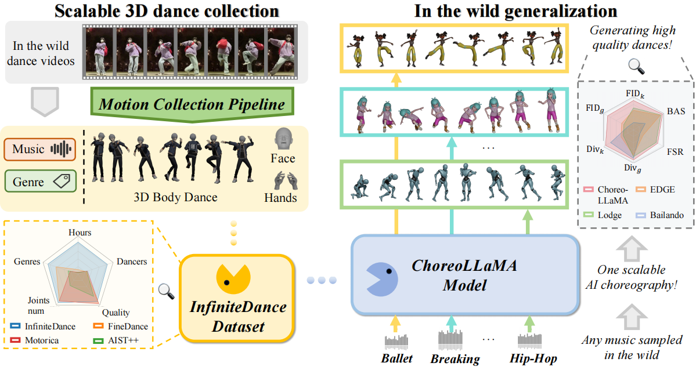
                            </td>
                    <td>
                            <b>InfiniteDance: Scalable 3D Dance Generation Towards in-the-wild Generalization</b>
                     
                    <strong>Ronghui Li</strong>, Zhongyuan Hu, Siyao Li, Youliang Zhang, Haozhe Xie, Mingyuan Zhang, Jie Guo, Xiu Li, Ziwei Liu.
                     
                    <em>European Conference on Computer Vision (ECCV 2026)</em>
                     
                    [<a href="https://infinitedance.github.io/">Project</a>][<a href="https://arxiv.org/abs/2603.13375">Paper</a>][<a href="https://github.com/MotrixLab/InfiniteDance">Code</a>]
                    </td>
                </tr>
                <tr>
                    <td width="40%">
                        
                            </td>
                    <td>
                            <b>Lodge++: High-quality and Long Dance Generation with Vivid Choreography Patterns</b>
                     
                    <strong>Ronghui Li</strong>, Hongwen Zhang, Yachao Zhang, Yuxiang Zhang,  Youliang Zhang,  Jie Guo, Yan Zhang, Xiu Li, Yebin Liu.
                     
                    <em>IEEE Transactions on Pattern Analysis and Machine Intelligence. (Accepted)</em>
                     
                    [<a href="https://li-ronghui.github.io/lodgepp">Project</a>][<a href="https://ieeexplore.ieee.org/document/11193731">Paper</a>][<a href="https://github.com/li-ronghui/LODGE">Code</a>]
                    </td>
                </tr>
                <tr>
                    <td width="40%">
                        
                            </td>
                    <td>
                            <b>Lodge: A Coarse to Fine Diffusion Network for Long Dance Generation Guided by the Characteristic Dance Primitives</b>
                     
                    <strong>Ronghui Li</strong>, Yuxiang Zhang, Yachao Zhang, Yachao Zhang, Hongwen Zhang, Jie Guo, Yan Zhang, Yebin Liu, Xiu Li.
                     
                    <em>IEEE/CVF Conference on Computer Vision and Pattern Recognition (CVPR 2024)</em>
                     
                    [<a href="https://li-ronghui.github.io/lodge">Project</a>][<a href="http://arxiv.org/abs/2403.10518">Paper</a>][<a href="https://github.com/li-ronghui/LODGE">Code</a>]
                    </td>
                </tr>
                <tr>
                    <td width="40%">
                        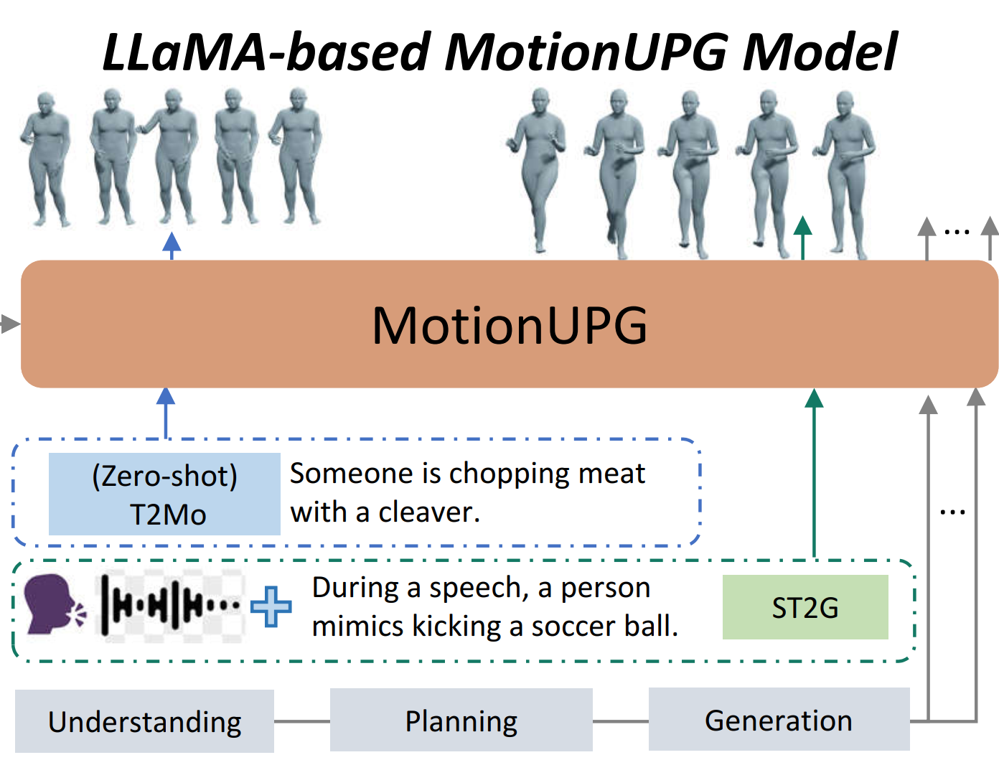
                            </td>
                    <td>
                            <b>A Motion is Worth a Hybrid Sentence: Taming Language Model for Unified Motion Generation by Fine-grained Planning</b>
                     
                    <strong>Ronghui Li</strong>, Lingxiao Han, Shi Shu, Yueyao Liu, Yukang Lin, Yue Ma, Jie Guo, Ziwei Liu, Xiu Li.
                     
                    <em>ACM International Conference on Multimedia. (ACM MM 2025)</em>
                     
                    [<a href="https://li-ronghui.github.io/motionupg.github.io/">Project page</a>]
                    </td>
                </tr>
                <tr>
                    <td width="40%">
                        
                            </td>
                    <td>
                            <b>FineDance: A Fine-grained Choreography Dataset for 3D Full Body Dance Generation</b>
                     
                    <strong>Ronghui Li</strong>, Junfan Zhao,  Yachao Zhang, Mingyang Su, Zeping Ren, Han Zhang, Yansong Tang, Xiu Li.
                     
                    <em>IEEE/CVF Conference on International Conference on Computer Vision (ICCV 2023)</em>
                     
                    [<a href="https://li-ronghui.github.io/finedance">Project</a>][<a href="https://arxiv.org/abs/2212.03741">Paper</a>][<a href="https://github.com/li-ronghui/FineDance">Code</a>]
                    </td>
                </tr>
                <tr>
                    <td width="40%">
                        
                            </td>
                    <td>
                            <b>Harmonious Group Choreography with Trajectory-Controllable Diffusion</b>
                     
                    Yuqin Dai, Wanlu Zhu, <strong>Ronghui Li</strong>, Zeping Ren, Xiangzheng Zhou, Xiu Li, Jun Li1, Jian Yang.
                     
                    <em>Association for the Advance of Artificial Intelligence (AAAI 2025)</em>
                     
                    [<a href="https://wanluzhu.github.io/TCDiffusion/">Project</a>][<a href="https://arxiv.org/abs/2403.06189">Paper</a>][<a href="https://github.com/Da1yuqin/TCDiff">Code</a>]
                    </td>
                </tr>
                <tr>
                    <td width="40%">
                        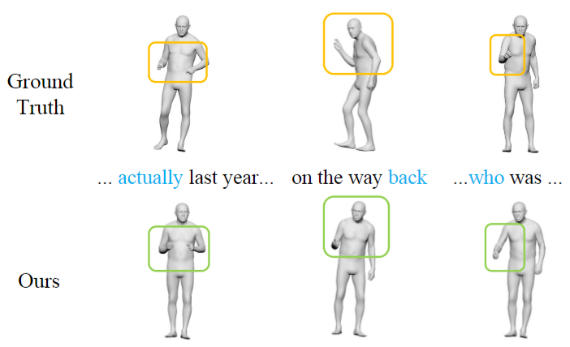
                            </td>
                    <td>
                            <b>MambaTalk: Efficient Holistic Gesture Synthesis with Selective State Space Models</b>
                     
                    Zunnan Xu, Yukang Lin, Haonan Han, Sicheng Yang, <strong>Ronghui Li</strong>, Yachao Zhang, Xiu Li.
                     
                    <em>Annual Conference on Neural Information Processing Systems (NeurIPS 2024)</em>
                     
                    [<a href="https://kkakkkka.github.io/MambaTalk/">Project</a>][<a href="https://arxiv.org/abs/2403.09471">Paper</a>][<a href="https://github.com/kkakkkka/MambaTalk">Code</a>]
                    </td>
                </tr>
                <tr>
                    <td width="40%">
                        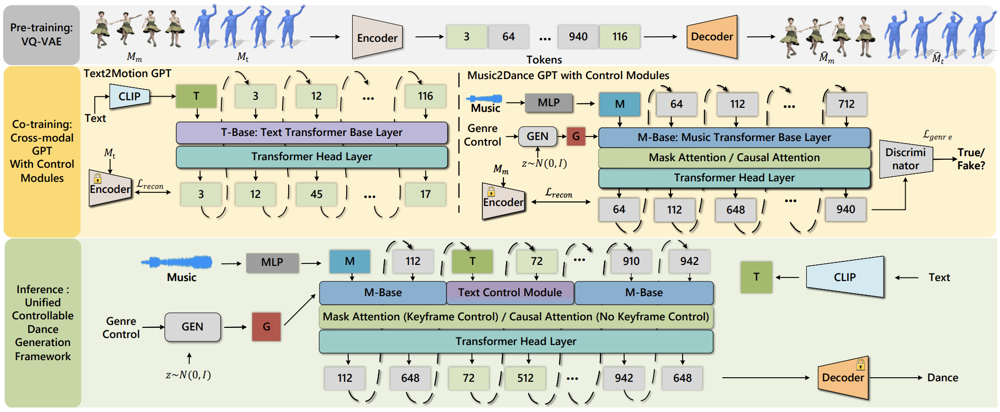
                            </td>
                    <td>
                            <b>Exploring Multi-Modal Control in Music-Driven Dance Generation</b>
                     
                    <strong>Ronghui Li</strong>, Yuqin Dai, Yachao Zhang, Jun Li, Jian Yang, Jie Guo, Xiu Li.
                     
                    <em>IEEE International Conference on Acoustics, Speech and Signal Processing
 (ICASSP 2024)</em>
                     
                    [<a href="https://arxiv.org/abs/2401.01382">Paper</a>]
                    </td>
                </tr>
                <tr>
                    <td width="40%">
                        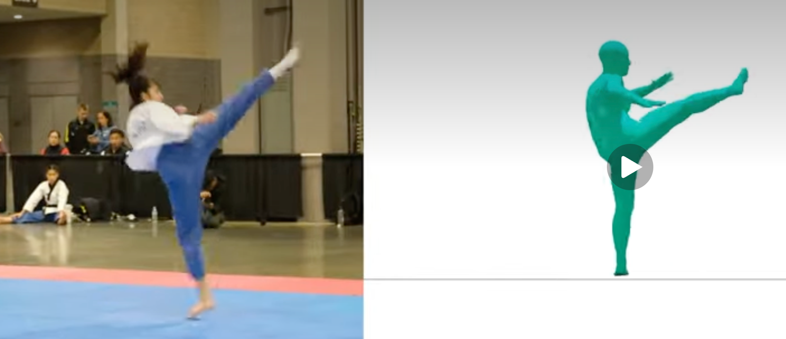
                            </td>
                    <td>
                            <b>A Plug-and-Play Physical Motion Restoration Approach for In-the-Wild High-Difficulty Motions</b>
                     
                    Youliang Zhang★, <strong>Ronghui Li</strong>★, Yachao Zhang, Liang Pan, Jingbo Wang, Yebin Liu, Xiu Li. 
                     
                    <em>IEEE/CVF Conference on International Conference on Computer Vision (ICCV 2025)</em>
                     
                    [<a href="https://physicalmotionrestoration.github.io/">Project</a>][<a href="https://openaccess.thecvf.com/content/ICCV2025/papers/Zhang_A_Plug-and-Play_Physical_Motion_Restoration_Approach_for_In-the-Wild_High-Difficulty_Motions_ICCV_2025_paper.pdf">Paper</a>]
                    </td>
                </tr>
                <tr>
                    <td width="40%">
                        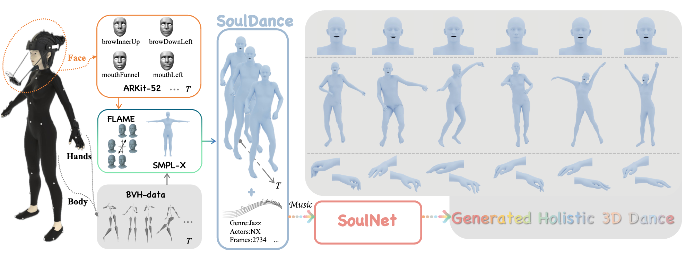
                            </td>
                    <td>
                            <b>SoulDance: Music-Aligned Holistic 3D Dance Generation.</b>
                     
                    Xiaojie Li, <strong>Ronghui Li</strong>, Shukai Fang, Shuzhao Xie, Xiaoyang Guo, Jiaqing Zhou, Junkun Peng, Zhi Wang. 
                     
                    <em>IEEE/CVF Conference on International Conference on Computer Vision (ICCV 2025)</em>
                     
                    [<a href="https://xjli360.github.io/SoulDance/">Project</a>][<a href="https://arxiv.org/abs/2507.14915">Paper</a>][<a href="https://github.com/xjli360/SoulDance-Official">Code</a>]
                    </td>
                </tr>
                <tr>
                    <td width="40%">
                        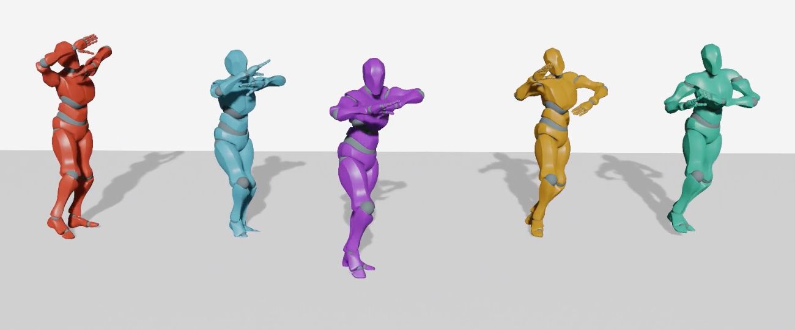
                            </td>
                    <td>
                            <b>TCDiff++: An End-to-end Trajectory-Controllable Diffusion Model for Harmonious Music-Driven Group Choreography.</b>
                     
                    Yuqin Dai, Wanlu Zhu, <strong>Ronghui Li</strong>, Xiu Li, Zhenyu Zhang, Jun Li, Jian Yang. 
                     
                    <em>International Journal of Computer Vision (IJCV)</em>
                     
                    [<a href="https://da1yuqin.github.io/TCDiffpp.website/">Project</a>][<a href="https://arxiv.org/pdf/2506.18671">Paper</a>][<a href="https://github.com/Da1yuqin/TCDiffpp">Code</a>]
                    </td>
                </tr>
                <tr>
                    <td width="40%">
                        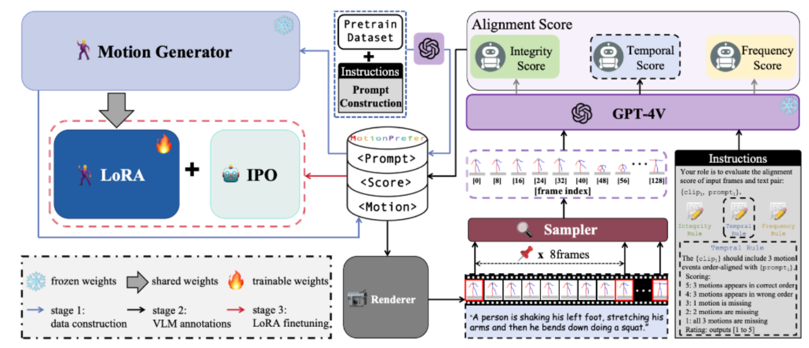
                            </td>
                    <td>
                            <b>AToM: Aligning Text-to-Motion Model at Event-Level with GPT-4Vision Reward.</b>
                     
                    Haonan Han, Xiangzuo Wu, Huan Liao, Zunnan Xu, Zhongyuan Hu, </strong>Ronghui Li</strong>, Yachao Zhang, Xiu Li. 
                     
                    <em>IEEE/CVF Conference on Computer Vision and Pattern Recognition (CVPR 2025)</em>
                     
                    [<a href="https://atom-motion.github.io/">Project</a>][<a href="https://arxiv.org/pdf/2411.18654">Paper</a>][<a href="https://github.com/VincentHancoder/AToM">Code</a>]
                    </td>
                </tr>
                <tr>
                    <td width="40%">
                        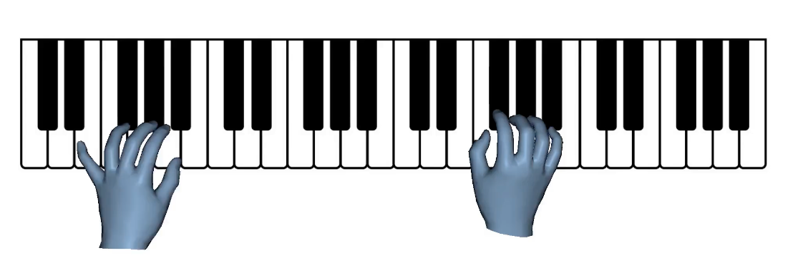
                            </td>
                    <td>
                            <b>Separate to Collaborate: Dual-Stream Diffusion Model for Coordinated Piano Hand Motion Synthesis.</b>
                     
                    Zihao Liu, Mingwen Ou, Zunnan Xu, Jiaqi Huang, Haonan Han, <strong>Ronghui Li</strong>, Xiu Li.
                     
                    <em>ACM International Conference on Multimedia (ACM MM 2025)</em>
                     
                    [<a href="https://monkek123king.github.io/S2C_page/">Project</a>][<a href="https://arxiv.org/abs/2504.09885">Paper</a>][<a href="https://github.com/monkek123King/S2C">Code</a>]
                    </td>
                </tr>
                <tr>
                    <td width="40%">
                        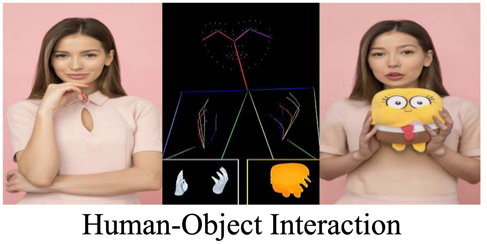
                            </td>
                    <td>
                            <b>Interanimate: Taming region-aware diffusion model for realistic human interaction animation.</b>
                     
                    Yukang Lin, Yan Hong, Zunnan Xu, Xindi Li, Chao Xu, Chuanbiao Song, <strong>Ronghui Li</strong>, Haoxing Chen, Jun Lan, Huijia Zhu, Weiqiang Wang, Jianfu Zhang, Xiu Li. 
                     
                    <em>ACM International Conference on Multimedia (ACM MM 2025)</em>
                     
                    [<a href="https://arxiv.org/abs/2507.14915">Project</a>][<a href="https://arxiv.org/abs/2507.14915">Paper</a>]
                    </td>
                </tr>
                <tr>
                    <td width="40%">
                        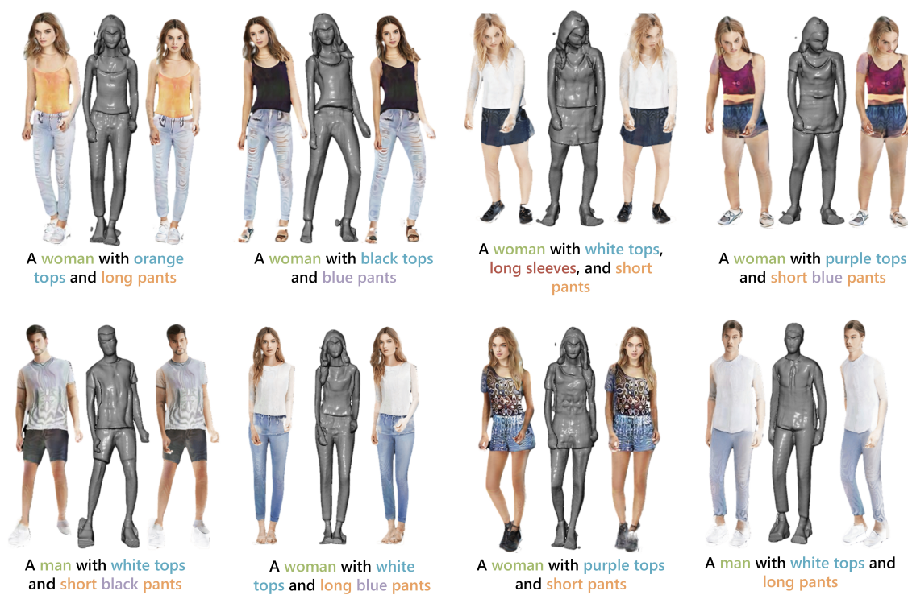
                            </td>
                    <td>
                          <b>Text2Avatar: Text to 3D Human Avatar Generation with Codebook-Driven Body Controllable Attribute</b>
                     
                    Chaoqun Gong, Yuqin Dai, <strong>Ronghui Li</strong>, Achun Bao, Jun Li, Jian Yang, Yachao Zhang, Xiu Li.
                     
                    <em>IEEE International Conference on Acoustics, Speech and Signal Processing
 (ICASSP 2024)</em>
                     
                    [<a href="https://browse.arxiv.org/abs/2401.00711">Paper</a>]
                    </td>
                </tr>
                <tr>
                    <td width="40%">
                        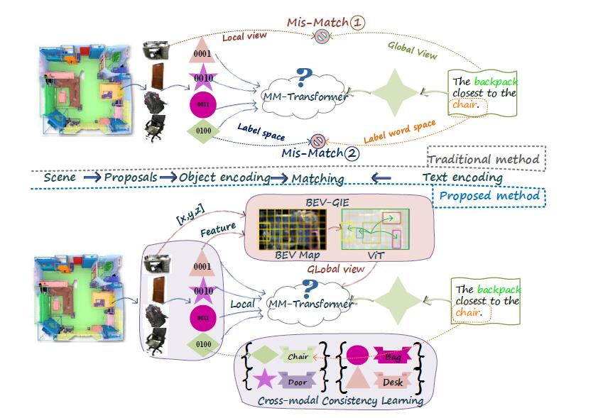
                            </td>
                    <td>
                            <b>Cross-Modal Match for Language Conditioned 3D Object Grounding</b>
                     
                    Yachao Zhang, Runze Hu, <strong>Ronghui Li</strong>, Yanyun Qu, Yuan Xie, Xiu Li.
                     
                    <em>Association for the Advance of Artificial Intelligence (AAAI 2024)</em>
                     
                    [<a href="https://github.com/li-ronghui">Paper</a>]
                    </td>
                </tr>
               <tr>
                    <td width="40%">
                        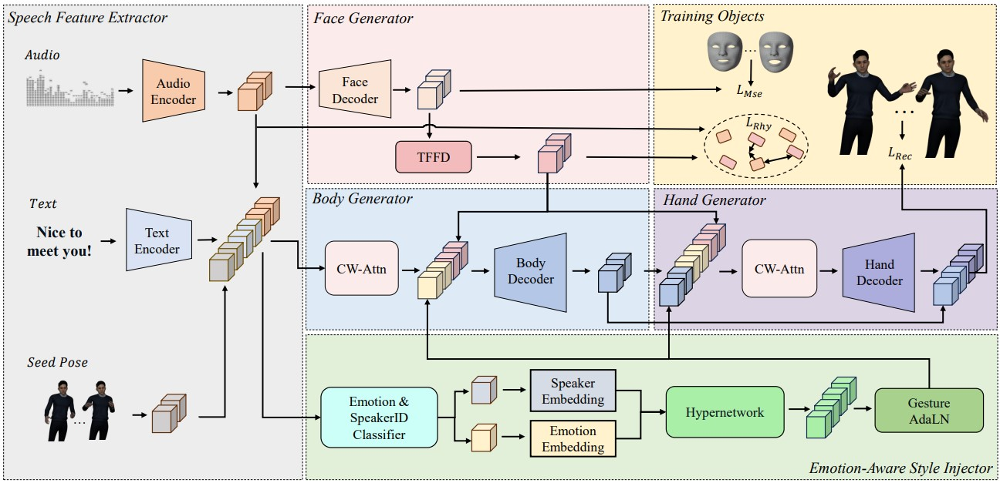
                            </td>
                    <td>
                            <b>Chain of Generation: Multi-Modal Gesture Synthesis via Cascaded Conditional Control</b>
                     
                     Zunnan Xu，Yachao Zhang，Sicheng Yang，<strong>Ronghui Li</strong>，Xiu Li.
                     
                    <em>Association for the Advance of Artificial Intelligence (AAAI 2024)</em>
                     
                   [<a href="https://arxiv.org/abs/2312.15900">Paper</a>]
                    </td>
               </tr>
                    </tbody>
           </table>

<!-- [Please visit [my google scholar profile](https://scholar.google.com/citations?hl=en&user=h1PooycAAAAJ) for the full publication list.] -->

_______________________________________________________________________________________________________

<!-- <h3>
   🚩Academic Services
</h3>

  <ul>
  <li> <strong>Emergency Conference Reviewer</strong>: CVPR </li>
  <li> <strong>Journal Reviewer</strong>: International Journal of Human-Computer Interaction (IJHCI)</li>
  </ul>

 -->
